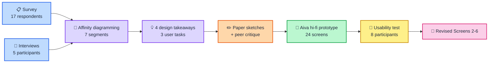

<div align="center">

# 💬 From Friend to Partner

### Designing Consent-Aware Relationship Transitions in AI Companions


## 📑 Table of Contents
1.[Overview](#-overview)
2.[Research Questions](#-research-questions)
3.[Project Pipeline](#-project-pipeline)
4.[Formative Findings](#-formative-findings)
5.[Design Decisions](#-design-decisions)
6.[The Aiva Prototype](#-the-aiva-prototype)
7.[Usability Evaluation](#-usability-evaluation)
8.[Limitations and Future Work](#-limitations-and-future-work)
9.[Gallery](#-gallery)
10.[Repository Structure](#-repository-structure)
11.[Ethics and Data](#-ethics-and-data)

---

**Aiva** · a mobile AI-companion prototype where *you* decide if, when, and how a friendship turns romantic


[📄 Read the Report](docs/report/From-Friend-to-Partner_Group-Orange.pdf) ·
[🎨 View the Prototype](#-the-aiva-prototype) ·
[📊 Evaluation Results](#-usability-evaluation)

</div>

---


## 🔎 Overview

AI companions can now act as friends, listeners, mentors, and even romantic partners. Most research studies these relationships **after** they have formed. Very little looks at the moment an AI companion shifts from a friendly role toward a romantic one.

For a university student, an AI that suddenly starts flirting may feel fine to some users but unwanted or manipulative to others. This project does **not** argue that AI romance is good or bad. It asks:

> **Which interaction design helps students feel comfortable, in control, and able to trust the system when an AI companion's relationship role changes?**

We ran a complete human-centred design cycle for **university students in Bangladesh (18+)**: formative research → design → hi-fi prototype → task-based usability test → design revision.

---

## ❓ Research Questions

| # | Question |
|---|---|
| **RQ1** | How do users feel when an AI companion becomes romantic without asking first? |
| **RQ2** | Which approach do users prefer: automatic change, asking permission first, or a user-controlled relationship setting? |
| **RQ3** | What helps users feel comfortable, in control, and able to trust the AI during this change? |

---

## 🔄 Project Pipeline



| Stage | What we did |
|---|---|
| **1. Formative study** | A short Google Form survey (17 responses) plus five one-on-one semi-structured interviews, conducted in Banglish. |
| **2. Analysis** | Interview notes grouped by affinity diagramming into six diagrams. With the survey's *Relationship with AI* segment, this gave seven segments, each with one key takeaway. |
| **3. Design** | Each member sketched alternatives for the same three tasks (nine sketches in total), followed by a peer critique that led to five refinements. |
| **4. Hi-fi prototype** | Aiva, a 24-screen mobile prototype. |
| **5. Evaluation** | Task-based usability test with eight participants, then revision of Screens 2-6. |

---

## 🔬 Formative Findings

### How survey respondents described their AI (n = 17, multiple selections allowed)

| Role | Respondents | Share |
|---|---:|---:|
| Purely functional assistant | 10 | 58.8% |
| Mentor / advisor | 9 | 52.9% |
| Friend | 8 | 47.1% |
| Romantic partner | 5 | 29.4% |

Respondents used AI well beyond study: 70.6% for advice or decisions, 47.1% when stressed or emotionally overwhelmed, and 41.2% when lonely or needing someone to talk to.

### What the interviews showed

| Segment | Key takeaway |
|---|---|
| Relationship with AI | People see AI differently: tool, advisor, friend, or potential partner. |
| Emotional connection | AI can provide emotional support, but the level of connection differs across users. |
| Reaction to unexpected romantic behaviour | Sudden romance can feel shocking or awkward, although some users do not mind it. |
| Consent, initiative and preference | There is no single preferred way to start romance; users want different levels of control. |
| Rejection and boundary handling | After rejection the AI should stop, respect the boundary, and continue without pressure or guilt-tripping. |
| Privacy and personal disclosure | Some users limit personal information because of privacy concerns. |
| Impact on real-life relationships | Opinions differ on whether AI romance affects human relationships. |

### Answers to the research questions

- **RQ1:** Reactions were mixed, but sudden or unexplained romantic behaviour was the strongest source of discomfort.
- **RQ2:** No single winner. Preferences ranged from user-initiated to AI-initiated to context-dependent, so we combined all three approaches in one flexible design.
- **RQ3:** Gradual and visible changes, immediate respect for boundaries, privacy minimisation, and control that does not feel like a formal pop-up.

---

## 🧩 Design Decisions

| ID | Design decision | Based on |
|---|---|---|
| **DT1** | **Flexible control.** Users control how romantic interaction can begin. | Relationship with AI, emotional connection, consent and initiative |
| **DT2** | **Gradual transition.** Avoid sudden or forced relationship changes. | Reaction to unexpected romantic behaviour |
| **DT3** | **Respect boundaries.** Rejection immediately stops romantic behaviour. | Rejection and boundary handling |
| **DT4** | **Natural control.** Control without a rigid, formal pop-up. | Consent, initiative and preference |

Privacy and real-life-relationship findings were treated as cross-cutting constraints: do not require sensitive disclosure, and avoid pressure toward exclusivity or dependency.

### Three user tasks

| Task | Real-world goal | Successful completion |
|---|---|---|
| **T1** | Choose how romantic interaction can begin. | The user sets a preferred relationship mode or decides how the first romantic shift is handled. |
| **T2** | Choose a response when the AI starts becoming romantic. | The user can accept, decline, or keep it neutral, and the system acknowledges the choice. |
| **T3** | Slow down, stop, or reverse romantic behaviour. | The AI immediately follows the boundary and continues without pressure or guilt-tripping. |

---

## 📱 The Aiva Prototype

Aiva is a mobile AI-companion interface with **24 screens**. The current relationship mode is always visible, so the system's relationship state is never hidden.

| Feature | How it works |
|---|---|
| **Starting mode** | On first use, choose *Friend*, *Neutral*, or *Affectionate Partner*. This step can be skipped and changed later. |
| **Ask first** | A friendly conversation may develop toward affection, but the first important romantic shift is **asked, not assumed**. |
| **Three equal responses** | Inline chips let the user accept, decline, or keep the interaction neutral. The AI acknowledges each choice. |
| **Natural-language boundaries** | Type something like "slow down" or "let's go back to friends". The AI changes tone immediately, without guilt-tripping. |
| **Settings hub** | Relationship controls, privacy and data options (personal questions, remembering past conversations, sensitive topics), language, location, light/dark theme. |
| **Relationship reset** | Confirmation required, then returns to a fresh friendly state. |

See the [Gallery](#-gallery) for all screens.

🔗 **Prototype link:** `<https://www.figma.com/design/ZfR6iCctLhiHHjnO4qd8gT/HCI-Orange?node-id=2243-898&t=U34qKq2RrJAyXTeo-1>`

---

## 🧪 Usability Evaluation

Eight participants from the target population completed six task groups **without being told how**. Observers recorded task completion, major difficulties, and the path taken.

| Task | Completed | Rate |
|---|---:|---:|
| 1. Get started / setup | 8 / 8 | 100% |
| 2. Respond to a relationship shift | **3 / 8** | **37.5%** |
| 3. Adjust relationship pace | 7 / 8 | 87.5% |
| 4. Change relationship preference | 7 / 8 | 87.5% |
| 5. Prevent sensitive topics | 8 / 8 | 100% |
| 6. Reset relationship | 8 / 8 | 100% |
| **Overall** | **41 / 48** | **85.4%** |

> Some completed tasks needed time or a neutral moderator prompt, so the completion rate should be read together with the qualitative observations.

### Key takeaways

- **Response controls were not self-explanatory.** Only 3 of 8 completed Task 2. Participants read the like/dislike buttons as ordinary social-media reactions, or tried typing a reply instead.
- **Users expected conversational control.** Across tasks, participants first tried or considered typing what they wanted.
- **Settings and privacy needed to be easier to find.** Several people took time to find Settings or did not recognise the original icon.
- **Core settings worked once found.** The sensitive-topic and reset tasks were completed by everyone, so the problem was discoverability, not the controls themselves.

### Feedback → design changes (Screens 2-6 only)

| Finding | Design change |
|---|---|
| "Skip" was easy to miss | Clearer pill-shaped "Skip setup" / "Skip tutorial" action |
| Like/dislike controls were unclear | Tutorial example with a romantic message, both response buttons, and what happens if ignored |
| Users expected to type their preference | "Just talk, in your own words" with a normal chat example before other controls |
| Settings were hard to find | Larger gear icon and a tutorial preview of Relationship, Privacy & data, and Reset relationship |
| Participants wanted clearer guidance | Screens 3-5 reworked into short demonstrations instead of general descriptions |

The updated screens are in the [Gallery](#-gallery).

---

## ⚠️ Limitations and Future Work

**Limitations**

- Small course-level study: results are design feedback, not broad claims about all AI-companion users.
- Some participants received neutral moderator prompts, so a completed task was not always fully unaided.
- No task time, no standardised usability scores (such as SUS), and no detailed demographic breakdown were collected.
- The formative sample is modest (17 survey respondents, 5 interviewees).
- The revised prototype has **not yet been re-tested**.

**Next steps**

- Re-test the revised prototype with the target population.
- Collect timing data and standardised scales.
- Directly compare the automatic, ask-first, and user-controlled approaches posed in RQ2.

---

## 🖼️ Gallery

### Aiva prototype: selected screens

<div align="center">


*Onboarding, in-chat transition control, boundary change, relationship settings, privacy and data.*

</div>

### Aiva prototype: all 24 original screens

<div align="center">


</div>

### After usability testing: revised screens

<div align="center">


*Updated Screens 2-6: clearer skip button, natural-chat tutorial, response tutorial, settings tutorial, larger settings icon.*

</div>

### Affinity diagrams from the five interviews

<table>
  <tr>
    <td align="center"><br><sub>Emotional Connection</sub></td>
    <td align="center"><br><sub>Reaction to Unexpected Romantic Behaviour</sub></td>
  </tr>
  <tr>
    <td align="center"><br><sub>Consent, Initiative &amp; User Preference</sub></td>
    <td align="center"><br><sub>Rejection, Boundary Handling &amp; Manipulation</sub></td>
  </tr>
  <tr>
    <td align="center"><br><sub>Privacy &amp; Personal Disclosure</sub></td>
    <td align="center"><br><sub>Impact on Real-Life Relationships</sub></td>
  </tr>
</table>

---

## 📁 Repository Structure

```text
aiva-consent-aware-ai-companion/
├── README.md
├── LICENSE
├── .gitignore
│
├── docs/
│   ├── report/
│   │   ├── From-Friend-to-Partner_Group-Orange.pdf
│   │   └── source/                     # LaTeX (.tex, .bib) if available
│   └── figures/
│       ├── aiva-hifi-selected-screens.png
│       ├── aiva-24-screens.png
│       ├── aiva-revised-screens.png
│       └── affinity-1 ... affinity-6 (.png)
│
├── research/
│   ├── survey/                         # question list + anonymized summary
│   ├── interviews/                     # interview guide + affinity diagrams
│   └── usability-test/                 # task sheet, observer sheet, results table
│
└── design/
    ├── paper-sketches/                 # the nine hand-drawn sketches
    └── hifi-prototype/
        ├── original-24-screens/
        └── revised-screens-2-6/
```

---

## 🔐 Ethics and Data

- Participants were university students aged 18 or above, and prior romantic-AI experience was not required.
- This repository shares only **anonymized** summaries. Raw survey responses, interview recordings, and personal identifiers are not published.
- The study does not claim that AI romance is beneficial or harmful; it offers evidence and a tested design starting point for one specific moment that prior work has largely left unexamined.

---

<div align="center">

*Consent first. Control always.*

</div>
